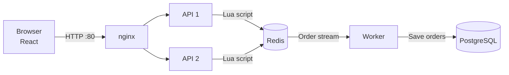

# Flash Sale System

A flash sale for a single product with limited stock. The sale runs only during a set time window, and each user can buy at most one item.

- Backend: Node.js, Express, TypeScript
- Frontend: React
- Data: Redis, PostgreSQL
- Runs locally with Docker Compose

## 1. Design choices and trade-offs

**Architecture:** nginx → 2 API instances → Redis → worker → PostgreSQL

- **The purchase decision is a single Redis Lua script.** It checks the sale window, checks whether the user has already bought, checks the stock, decrements the stock and records the order in one step. No other request can run in the middle of it. So even under heavy concurrent traffic, there is no overselling and no double purchase.
- **A separate worker writes orders to the database.** A purchase request only touches Redis and returns right away. Successful orders are added to a Redis Stream, and the worker saves them to PostgreSQL.
- **The API is stateless.** Adding more API instances behind nginx increases throughput.

**Trade-offs**

1. **Fast response vs. immediate persistence:** Purchase responses are fast, but orders reach PostgreSQL a little later. During the sale, Redis is the source of truth.
2. **Safety vs. availability:** If Redis is down, purchases are rejected instead of falling back to the database. The sale stops for a while, but there is no overselling. On the other hand, if one API instance, the worker or the database goes down, purchases continue. nginx sends requests to the other API instance, and orders stay in the Stream until they can be saved.
3. **Simplicity vs. a single Redis:** One Redis instance keeps the setup simple. But all purchases go through that one Redis, and if it goes down, all purchases stop.

## 2. System diagram



### Project structure

```
.
├── api/                      # Backend (Express, TypeScript)
│   ├── src/
│   │   ├── scripts/purchase.lua      # Purchase Lua script (core of concurrency control)
│   │   ├── services/                 # Sale, purchase and order logic
│   │   ├── workers/order.worker.ts   # Worker: Redis Stream → PostgreSQL
│   │   ├── routes/, controllers/     # API endpoints
│   │   ├── server.ts                 # API entry point
│   │   └── worker.ts                 # Worker entry point
│   └── test/                 # Integration tests (unit tests are *.spec.ts files in src)
├── web/                      # Frontend (React, Vite)
├── db/init.sql               # Creates the orders table
├── nginx/                    # nginx config (serves the React app, balances the 2 APIs)
├── stress/                   # k6 stress tests and the runner script (run.sh)
├── docker-compose.yml
└── .env.example              # Example settings (defaults are used without it)
```

## 3. Build and run

Requirements: Docker Desktop. Node.js 22 is also needed to run things locally.

### Backend

```bash
# Docker (recommended): runs nginx, 2 APIs, the worker, Redis and PostgreSQL
docker compose up -d --build

# Local
docker compose up -d postgres redis
cd api && npm ci && npm run build
npm start                 # API (port 3000)
node dist/worker.js       # Worker (in another terminal)
```

### Frontend

```bash
# Docker: started by the command above → http://localhost

# Local (start the local backend first)
cd web && npm ci
npm run dev               # http://localhost:5173
```

### Tests

```bash
cd api && npm ci
npm test                  # Unit tests
npm run test:e2e          # Integration tests (needs the postgres and redis containers)
```

Integration tests use separate test databases, so they do not touch the running demo data.

### Using the web page

- By default, the sale starts when the server starts, runs for 1 hour, and has 100 items.
- If the sale has ended, open **Admin · Demo controls** at the bottom of the page and click **Start now**. This is a demo tool for reviewers to change the sale state. It also resets all purchases.

## 4. Stress test

### How to run

```bash
docker compose up -d --build
./stress/run.sh
```

- k6 runs in a container, so nothing else needs to be installed. bash is required (WSL on Windows).
- For each scenario, the script resets the sale, runs k6, then compares the numbers in Redis and PostgreSQL and prints PASS or FAIL.
- The test resets the demo data. To use the web page again, click **Start now**.

### Expected results

| | Scenario A | Scenario B |
|---|---|---|
| Load | 10,000 different users (1,000 concurrent) | 1,000 concurrent requests from the same user |
| Stock | 100 | 100 |
| Expected | 100 succeed, 9,900 sold out, 0 server errors | 1 succeeds, 999 already purchased, 0 server errors |

Checks: total stock = remaining stock + number of buyers, Redis buyers = PostgreSQL orders, no duplicate users.

**Measured results** (everything on one Apple M4 Pro laptop, PASS in all 3 runs)

| | Throughput | p95 latency |
|---|---|---|
| A | about 9,000–11,000 req/s | about 750–950 ms |
| B | about 4,400–7,000 req/s | about 50–110 ms |

The p95 in A is high because 1,000 users send their first request at the same moment, so the first requests have to wait. k6 also runs on the same laptop.

## API

| Method | Path | Description |
|---|---|---|
| GET | `/api/sale` | Sale status (upcoming / active / ended) |
| POST | `/api/purchases` | Try to buy (`{ "userId": "user1" }`) |
| GET | `/api/purchases/:userId` | Check whether the user bought the item |